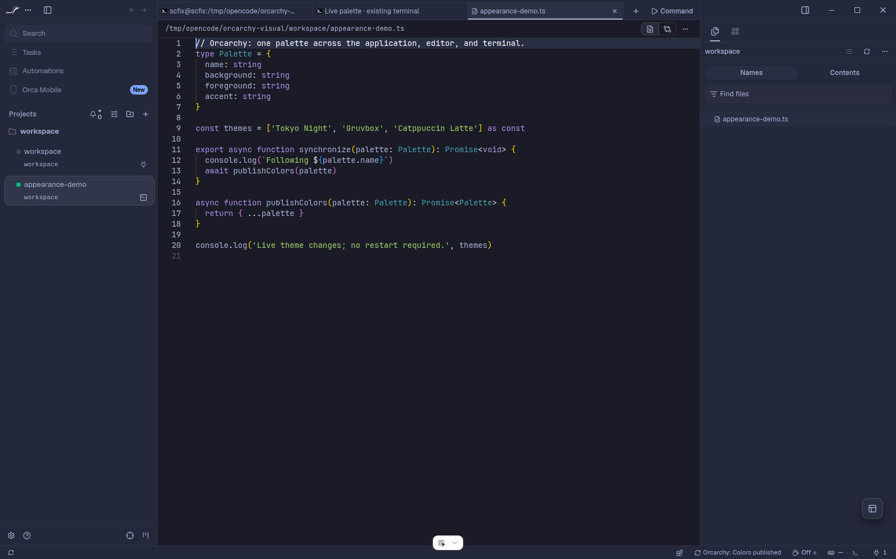
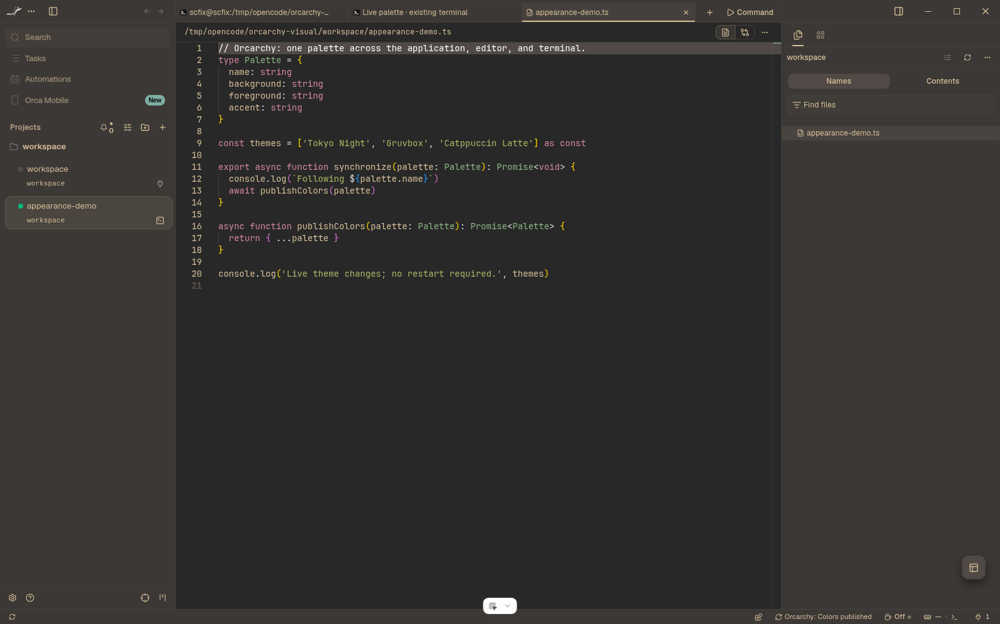
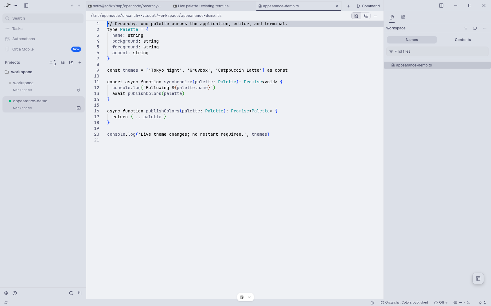
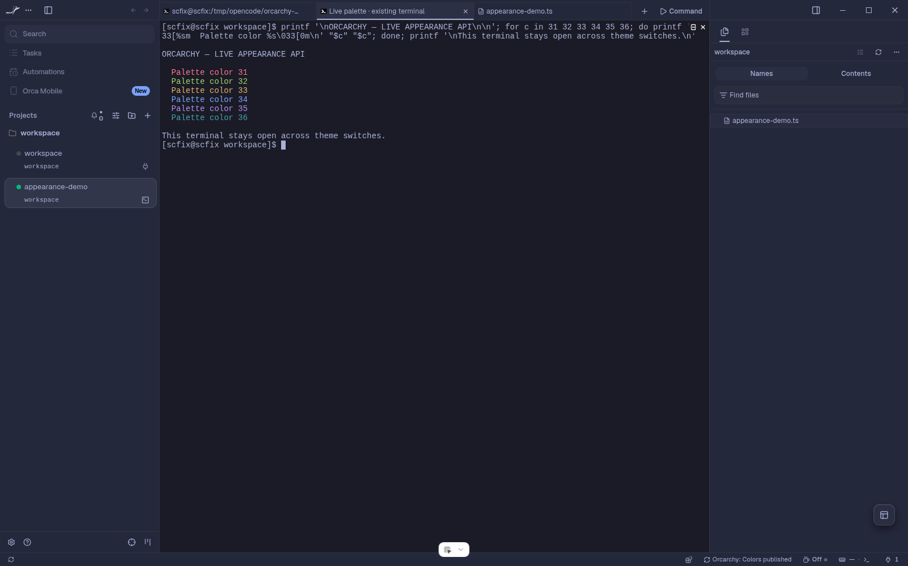
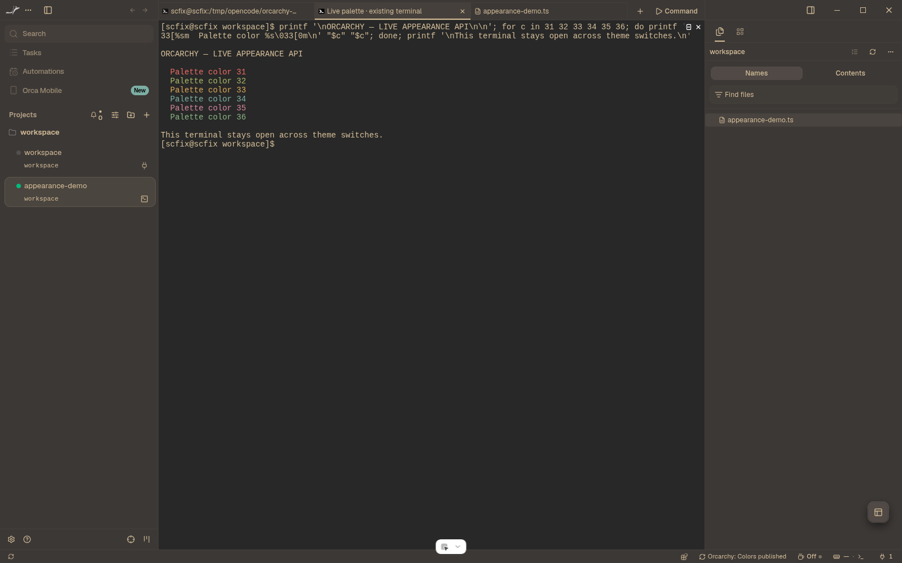
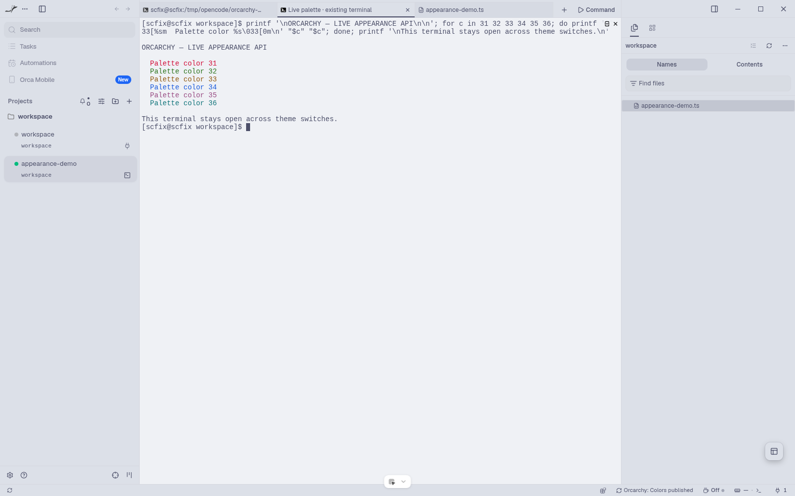

# Orcarchy

**Bring your Omarchy palette to Orca's interface, editor, and terminals.**

Orcarchy is a public-repo project for `wilkywayre`. Its target is an installable
Orca plugin that automatically follows Omarchy's colors, font families, and
backgrounds through owned OS hooks and supported Orca interfaces, including on
startup. Feature toggles preserve user choices; sizes, spacing, and opacity stay
untouched.

**[Experimental source extension implemented](upstream/README.md):** the local
Orca source branch now exposes a permissioned appearance-provider API, and this
repository contains a real worker plugin using it. Stock Orca still needs that API.

## Status

**Development preview, custom host required.** The color worker starts through
Orca's resident status-bar mechanism, rereads Omarchy on startup, and watches theme
changes while open. It supports master/Colors controls and leave-as-is disconnect.

The host extension publishes owned app/editor/terminal palettes, persists generated
resources separately from plugin code, and protects against stale, cancelled, or
revoked writes. Its source tests, full typecheck, CLI validator, and Electron/Vite
asset build pass. Isolated Linux testing verified live app/editor and existing-
terminal repaint across Tokyo Night, Gruvbox, and Catppuccin Latte without restart.

**Not implemented yet:** Omarchy OS hooks/closed-app snapshots, font/background
application, automatic manual-override reconciliation, and complete uninstall
resource lifecycle. Their requested settings are explicitly marked unavailable in
the preview. No user hooks or installed Orca settings have been changed.

See [source extension and validation](upstream/README.md) and the
[compatibility evidence](docs/compatibility.md). The experimental 1.4.249 schema
floor is not a claim of support in any stock release.

## Live preview

| Tokyo Night | Gruvbox | Catppuccin Latte |
| --- | --- | --- |
|  |  |  |
|  |  |  |

Actual custom-host Electron captures, not mockups. The same terminal's existing
output repainted across all three palettes. The test used a disposable profile
and HOME, atomically replacing its theme symlink; it did not change the user's
desktop theme. [Evidence and limits](https://github.com/Wilkywayre/orca/blob/0d526ee78ea87fb34d709bca7a9e0418d2d64ee3/README.md).

Proposed host API: [Orca PR #38282](https://github.com/stablyai/orca/pull/38282).

## Package the actual plugin preview

```bash
python tools/package-plugin.py --output dist/orcarchy
```

The output directory must be new. This packages only the worker, converter runtime,
manifest, README, and license—not the nested source checkout. Normal plugin
operation does not require converter commands or manually generated theme files.
Do not load the preview into your normal profile; it requires the custom host and
an explicitly approved isolated development test.

## Compatibility investigation

The read-only developer probe inventories a trusted local Orca installation
without loading a plugin, installing hooks, or changing appearance settings:

```bash
node tools/probe-orca.cjs
node tools/verify-appearance-proposal.cjs --bundle build/orcarchy
node --test tests/probe-orca.test.cjs tests/appearance-provider.test.cjs tests/plugin-sync.test.mjs
```

Node is needed only for this developer diagnostic, not the Python converter.
The probe reports evidence, not an automatic live-sync support verdict.
The proposal verifier checks data against actual installed Orca schemas; it does
not apply settings or demonstrate live rendering. The generated bundle must exist
before running it; generate one using the converter example below.

## Try the converter prototype locally

Requires Python 3.11+. No runtime dependencies or installation required:

```bash
# Preview your current Omarchy palette without writing anything.
PYTHONPATH=src python -m orcarchy --dry-run

# Generate a complete plugin bundle into a NEW directory.
PYTHONPATH=src python -m orcarchy --output build/orcarchy

# Generate a reproducible example without an Omarchy installation.
PYTHONPATH=src python -m orcarchy --palette tests/fixtures/dark.toml --output build/example

# Run the tests.
PYTHONPATH=src python -m unittest discover -s tests -v
```

Default input: `$XDG_STATE_HOME/omarchy/current/theme/colors.toml`, falling back
to `~/.local/state/omarchy/current/theme/colors.toml`.

Output contains `orca-plugin.json`, `themes/app.json`, and
`themes/terminal.json`. The output directory must not already exist: this initial
version deliberately refuses to overwrite bundles. Generated bundles require
Orca **1.4.246+**; actual installation and rendering compatibility remain unverified.

Optional development installation:

```bash
python -m venv .venv
.venv/bin/python -m pip install -e .
.venv/bin/orcarchy --help
```

## Safety and limitations

- Reads color data only; does not execute theme scripts.
- Never edits packaged Omarchy files, private Orca settings files, or user hooks.
  The approved worker applies appearance through the custom host's public API.
- Does not restart Orca or interrupt agent sessions.
- Accepts opaque `#RRGGBB` palette colors; unrelated metadata is ignored.
- Rejects unreadable background/text pairs. Adjusts generated text and syntax
  colors to readable fallbacks where necessary; terminal ANSI colors stay intact.
- Missing optional colors fall back to supplied palette colors, not another theme.
- The converter generates one app theme in the source palette's mode. The worker
  selects light/dark slots through the custom host; isolated Linux switching is
  verified, but other platforms and every restart scenario are not.
- Orca copies selected terminal palettes into settings. Regenerating files alone
  is **not** a guarantee of live terminal updates.
- Validates input before writing. An I/O failure can leave an incomplete **new**
  bundle; transactional replacement of installed bundles is future work.

## Project layout

```text
src/orcarchy/       Palette reader, pure converters, and CLI
plugin/            Actual worker and private converter bridge (custom-host preview)
tests/fixtures/    Synthetic light and dark palettes
tests/             Standard-library unit and CLI tests
tools/             Read-only installed Orca contract inventory
experiments/       Offline proposed host-side color preparation (not a plugin)
upstream/          Exported source patch, pinned metadata, license, and build notes
docs/              Architecture and compatibility notes
build/             Generated local bundles (gitignored)
dist/              Packaged runtime plugin (gitignored)
```

See [architecture](docs/architecture.md), [compatibility](docs/compatibility.md),
and [contributing](CONTRIBUTING.md).

## License

MIT. Not affiliated with Orca or Omarchy.
