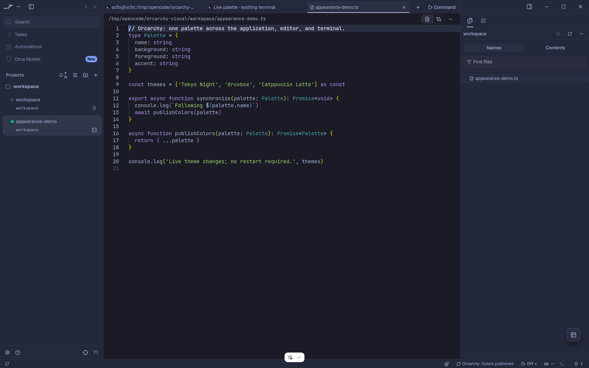
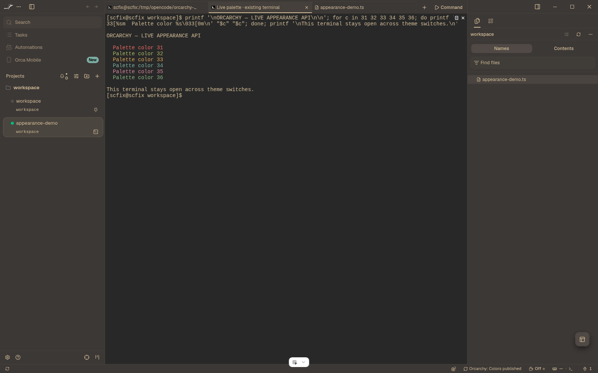
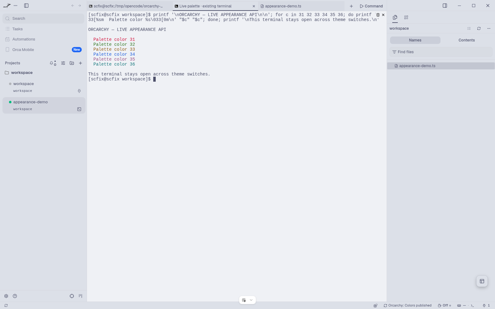

# Orcarchy

Automatically follows Omarchy colors when approved in Orca 1.4.251+.

The permissioned appearance provider (`appearance.read` / `appearance.apply`)
merged upstream in
[stablyai/orca#38524](https://github.com/stablyai/orca/pull/38524) and first
shipped in stock Orca 1.4.251. Older stock releases do not have this API.

## Live preview

| Gruvbox | Catppuccin Latte |
| --- | --- |
|  |  |

Real stock-Orca Electron captures from an isolated Linux profile on Orca 1.4.251.
The same app, editor file, and terminal survived all three palette changes
without restart. The test replaced a theme symlink under a disposable HOME, not
the user's desktop theme. [Method and limits](https://github.com/Wilkywayre/orca/blob/0d526ee78ea87fb34d709bca7a9e0418d2d64ee3/README.md).

Host API: merged as [Orca PR #38524](https://github.com/stablyai/orca/pull/38524), first shipped in stock 1.4.251.

## Requirements and permissions

- Linux with Omarchy and Python 3.11+ available as `python3`.
- Orca 1.4.251+ (stock release with the appearance provider).
- Approve the trusted worker, plugin-private settings, and appearance-write access
  through Orca's normal review flow. The worker has full machine access; review it.

The plugin starts automatically via its status-bar item. It reads the active
palette, converts it without writing generated theme files, and publishes app,
editor, and terminal colors through the new public facade. It rereads current
Omarchy state on every startup and watches the stable parent of the active theme
directory while open.

Automatic synchronization and Colors default on. Turn either off to stop color
writes. “Disconnect” persists the master opt-out and keeps the current appearance;
turn Automatic synchronization back on intentionally to resume. “Sync now” respects
the opt-out. No manual converter command is needed during normal use.

## What's next

- OS hooks for changes while Orca is closed (currently picked up on startup).
- Font family sync, once family-only host support lands. The Fonts toggle
  records your preference today but changes nothing yet.
- Background/wallpaper sync. The Backgrounds toggle records your preference
  today but changes nothing yet.
- Automatic reconciliation of manual Orca overrides.
- A watcher error is logged; Sync now retries watcher registration. No hidden
  background service or automatic application restart is used.
